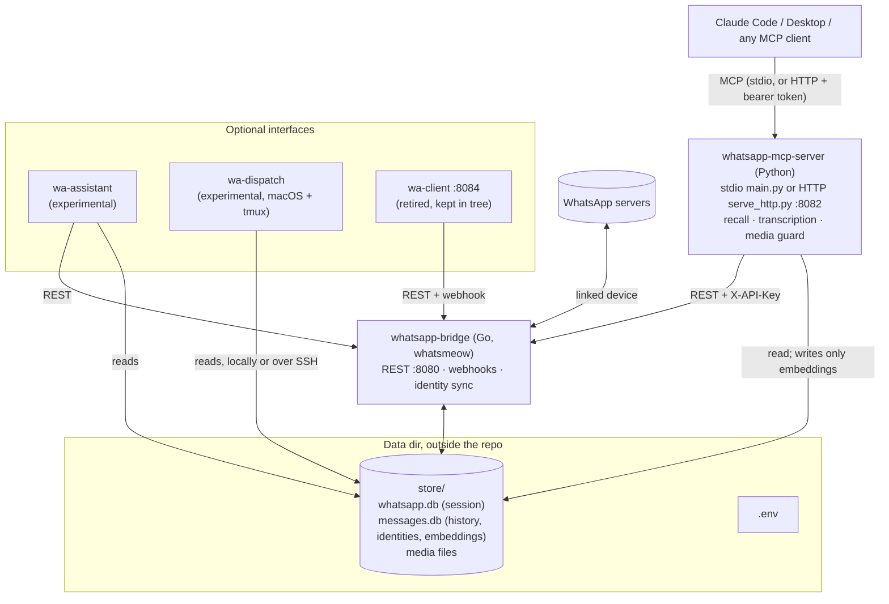

# Architecture — whatsapp-mcp-pro

A self-hosted WhatsApp layer for AI agents: a Go bridge that speaks the
WhatsApp Web protocol, a Python MCP server on top of it, and a few optional
interfaces around them. Everything runs on the user's own machine.

This is a fork of
[FelixIsaac/whatsapp-mcp-extended](https://github.com/FelixIsaac/whatsapp-mcp-extended),
itself descended from [lharries/whatsapp-mcp](https://github.com/lharries/whatsapp-mcp).
Upstream deliberately stays a lean transport primitive and keeps ML out of its
core. This fork is the batteries-included build: it adds recall, voice
transcription, an identity directory and the optional interfaces, while
tracking upstream's bridge and tool surface. Transcription and recall were
contributed back upstream, so both projects now carry them; ours are supersets.

## Overview



## Components

### whatsapp-bridge (Go)

A daemon on [whatsmeow](https://github.com/tulir/whatsmeow). It pairs as a
linked device (one of the account's four slots), keeps the session in
`store/whatsapp.db` and message history in `store/messages.db` (SQLite, WAL),
and exposes a REST API plus outbound webhooks.

Packages under `internal/`: `api` (HTTP handlers, auth, rate limits, the
API-layer send allowlist), `whatsapp` (client, events, sending, media, identity
sync), `database` (store and migrations), `webhook` (delivery, SSRF guard),
`antiban` (optional send pacing and warm-up), `config`, `security`, `types`.

Schema changes ship as append-only, idempotent SQL in
`whatsapp-bridge/migrations/`.

### whatsapp-mcp-server (Python)

An MCP server (mcp 2.x `MCPServer`) exposing about 35 tools, grouped into
toolsets (`WHATSAPP_MCP_TOOLSETS`). Every tool carries MCP annotations
(`readOnlyHint`, `destructiveHint`, ...). It reads `messages.db` directly for
queries and calls the bridge's REST API for anything that acts on WhatsApp.

Two ways to run it:

- **stdio** (`main.py`): one process per MCP client session. The pro toolsets
  (recall, audio, inbox) are opt-in here, so the default surface matches
  upstream's.
- **Shared HTTP** (`serve_http.py`, default `:8082`): one always-on process
  for any number of sessions, with every toolset enabled. Optional scoped
  bearer tokens: `WA_MCP_FULL_TOKEN` can call everything,
  `WA_MCP_READONLY_TOKEN` only tools annotated read-only, enforced
  server-side. With neither set, the bind address (`MCP_HOST`, loopback by
  default) is the only wall. This mode also runs the background recall
  indexer and, if enabled, auto-transcription of voice notes.

### Identity directory

The `identities` table in `messages.db` answers "who or what is this JID":
one row per person, group, newsletter or broadcast list, keyed on a canonical
JID (the phone JID when known) and carrying both the phone and LID forms,
every known name, the local nickname, flags, message counts and group
metadata.

WhatsApp files the same conversation under a phone JID on one device and a LID
on another, so anything that matches raw JIDs silently misses data. The bridge
owns the directory (`internal/whatsapp/identity.go`): it rebuilds on connect,
on contact and name events (coalesced by a worker) and every
`IDENTITY_SYNC_INTERVAL`, and first folds LID-filed chats into their phone-JID
twins (`MergeLIDChats`). The MCP server only reads it (`lib/identity.py`,
`lookup_identity`, `search_directory`). Every read degrades to the older
per-source queries if the table is missing.

### Recall and transcription (`--extra pro`)

- **Recall** (`lib/recall.py`): semantic search over history. Text messages
  and stored voice transcripts are embedded with a multilingual
  sentence-transformers model into a `message_embeddings` table inside
  `messages.db`, and ranked by cosine similarity at query time. Every query is
  scoped to the embedding model, so changing the model re-embeds instead of
  mixing dimensions. The model loads lazily and unloads when idle.
- **Transcription** (`lib/transcribe.py`): voice notes to text, local first.
  `WHISPER_BACKEND=auto` tries a whisper server, then MLX, then
  faster-whisper, and falls back to Groq if `GROQ_API_KEY` is set.

### Optional interfaces

| Interface | What it does | Status |
|---|---|---|
| `wa-assistant/` | Message your own chat and a persistent Claude Code session replies, with optional voice in both directions. Watches both of your identities (phone JID and LID). | Experimental |
| `wa-dispatch/` | A message in a routed chat opens or wakes a Claude Code session in the matching project. Sessions draft replies but cannot send; a deny-hook blocks outbound tools, and `wa-approve` relays a draft only after a human taps Send. macOS + tmux. | Experimental |
| `wa-client/` | A chat web UI that rides the bridge's session (no extra device slot). | Retired: no longer run by the maintainer, kept in the tree |
| `whatsapp-web-ui/` | Upstream's Next.js admin panel for pairing and webhooks. Not a chat client. | From upstream |
| `plugins/` | Upstream's plugin notes. | From upstream |

## Deployment model

### Code and data are separate

The services run straight out of the repository checkout, but all state lives
in a data directory outside it (for example `~/.local/share/whatsapp-mcp-pro/`):

```
<repo>/                  code: the bridge binary, the MCP server's venv
<data>/.env              configuration and secrets
<data>/store/            session, history, media
```

The bridge writes `store/` relative to its working directory, so its service
sets `WorkingDirectory=<data>`. The MCP server finds the same store through
`WA_STORE_PATH`. Nothing stateful lives in the repo, which keeps sessions and
history out of git and lets the code be rebuilt or updated without touching
data. `scripts/deploy-live.sh` builds and tests, backs up the store online,
swaps the binary (keeping the previous one for rollback) and restarts.

### One process per number

The bridge serves exactly one WhatsApp account. To run several numbers on one
machine, run the same binary several times, each with its own data directory,
`.env`, `API_KEY` and REST port. Nothing is shared between them except the
binary. `deploy-live.sh` restarts and health-checks every listed bridge
(`OTHER_BRIDGES`) and rolls them back together if any fails to reconnect.

### Health

A bridge can be alive and bound to its port while ingesting nothing (for
example after a cold start before DNS was ready). The only honest signal is
`"connected": true` from `GET /api/connection`; watchdogs and
`scripts/wabridge.sh` check that rather than the process.

## Security boundaries

- **Network:** the bridge binds `API_BIND_HOST` (loopback by default) and
  every endpoint requires `X-API-Key`. The shared MCP server binds `MCP_HOST`
  (loopback by default) with optional scoped tokens.
- **Sending:** two independent recipient allowlists, `SEND_ALLOWED_JIDS` at the
  HTTP layer and `WHATSAPP_ALLOWLIST_JIDS` at the whatsmeow send call. Matching
  is exact.
- **Media guard:** local file paths for sending are confined to built-in roots
  plus `MEDIA_ALLOWED_DIRS`. Both the bridge and the MCP server check, and both
  refuse traversal, hidden path segments, secret files and databases.
- **Webhooks:** private targets are blocked unless listed in
  `WEBHOOK_ALLOWED_ADDRS`.

See [.github/SECURITY.md](.github/SECURITY.md) for the threat model.
