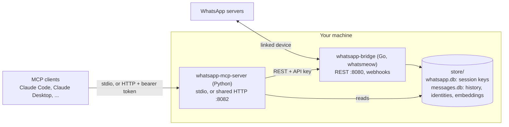

# whatsapp-mcp-pro

Self-hosted WhatsApp for AI agents: an MCP server with semantic search across your
whole history, local voice-note transcription, and the safety rails you need
before you point automation at a real account.

[](https://github.com/simonseifert/whatsapp-mcp-pro/actions/workflows/go-test.yml)
[](https://github.com/simonseifert/whatsapp-mcp-pro/actions/workflows/lint.yml)
[](https://github.com/simonseifert/whatsapp-mcp-pro/actions/workflows/python-test.yml)
[](LICENSE)
[](https://github.com/simonseifert/whatsapp-mcp-pro/releases)
[](whatsapp-bridge/go.mod)
[](whatsapp-mcp-server/pyproject.toml)

## What it is

A Go bridge pairs with your WhatsApp account as a linked device (the same way
WhatsApp Web does), stores your history in SQLite on your machine, and exposes a
local REST API. A Python MCP server sits on top and gives any MCP client (Claude
Code, Claude Desktop, others) 37 tools to read, search, send, and manage chats.
Nothing goes to a third party unless you choose a hosted transcription backend.

It is a fork of [FelixIsaac/whatsapp-mcp-extended](https://github.com/FelixIsaac/whatsapp-mcp-extended)
that adds a "pro" layer: recall, transcription, an identity directory, a shared
HTTP server with scoped tokens, and hardening from running it daily. See
[Credits](#credits-and-upstream) for how the two relate.

<!-- demo GIF: recall across languages, to be recorded -->

- **Set it up:** [Quickstart](#quickstart) below, or [SETUP.md](SETUP.md) for the
  full walkthrough. SETUP.md is written so an AI agent can follow it for you.
- **What changed:** [CHANGELOG.md](CHANGELOG.md). **Where it's going:** [ROADMAP.md](ROADMAP.md).

## Account safety

Read this before you pair a number you care about.

- **This is an unofficial client.** It speaks WhatsApp's linked-device protocol
  through [whatsmeow](https://github.com/tulir/whatsmeow), like every other
  self-hosted WhatsApp bridge. Using it breaks WhatsApp's terms of service, and
  accounts do get banned. 2025-26 saw ban waves that hit low-volume personal bots
  too. No unofficial client is safe, only quiet.
- **It takes one linked-device slot** (WhatsApp allows four). Your phone stays
  the primary device and keeps working normally.
- **What gets accounts banned:** first contact with people who don't have your
  number, bulk or templated sends, high send rates from a fresh number, and
  posting status from a server. Replying inside existing conversations is the
  low-risk pattern.
- **What this repo does about it:**
  - Two send allowlists (`SEND_ALLOWED_JIDS` at the HTTP layer,
    `WHATSAPP_ALLOWLIST_JIDS` at the send call). Matching is exact, never
    substring. Set both before you let an agent send.
  - Opt-in pacing (`ANTIBAN_ENABLED=true`): randomised delays, typing
    simulation, a warm-up cap for new numbers, a risk score that pauses sending.
  - Presence stays offline by default and only goes online briefly around real
    sends, so your phone keeps its push notifications.
  - No status posting and no bulk-send tools, on purpose.
- **Advice:** if you're building something that sends a lot, use a dedicated
  number. Keep your own number for reading, recall and replies.

## Status

| Component | Status | What it is |
|---|---|---|
| [`whatsapp-bridge/`](whatsapp-bridge) | Stable, in daily use | Go daemon on whatsmeow. Linked device, SQLite store, REST API, HMAC-signed webhooks. |
| [`whatsapp-mcp-server/`](whatsapp-mcp-server) | Stable, in daily use | Python MCP server (mcp 2.x). stdio per session, or one shared HTTP server. |
| [`wa-client/`](wa-client) | Retired, unmaintained | Chat web UI that rode the bridge's session. Its `app.py` ignores `WA_STORE_PATH`, so it shows stale data once the store lives outside the repo. Has no login. |
| [`wa-assistant/`](wa-assistant) | Experimental, dormant | Text your own chat, a persistent Claude Code session replies. |
| [`wa-dispatch/`](wa-dispatch) | Experimental, dormant | An incoming message opens a Claude Code session in that client's project and drafts a reply. macOS + tmux. |
| [`whatsapp-web-ui/`](whatsapp-web-ui) | Upstream | Upstream's Next.js admin panel (pairing, webhooks). Not a chat client. |

## What the pro layer adds

Every WhatsApp MCP can send and read. These are the parts that aren't standard.

**Finding things in your history**

- **`recall`, semantic search.** Multilingual embeddings
  (paraphrase-multilingual-MiniLM, 50+ languages) over your full history, so
  *"what did we agree about the deadline six weeks ago?"* works without
  remembering the exact words, or the language they were in. Vectors live in the
  bridge's SQLite and a background indexer keeps them current. Runs on CPU and
  stays resident (about 700 MB), because on Apple Silicon the GPU path pinned a
  gigabyte of Metal buffers it never released.
- **`transcribe_audio`, voice notes.** Local transcription. With
  `AUTO_TRANSCRIBE_VOICE=true` incoming voice notes are transcribed in the
  background and written into the store, so speech is searchable by `recall`
  too. `WHISPER_BACKEND=auto` tries, in order:

  | Backend | Runs where | Notes |
  |---|---|---|
  | `whisper-server` | a whisper.cpp server at `WHISPER_SERVER_URL` | Fully local; good for offloading to a GPU box |
  | `mlx` | Apple Silicon | Fully local, mlx-whisper large-v3-turbo, about 1.5 GB RAM |
  | `faster-whisper` | any OS, CPU or GPU | Fully local, `uv sync --extra pro-cpu` |
  | `groq` | Groq's API | Needs `GROQ_API_KEY`; audio leaves the machine; near-zero RAM |

- **`check_inbox`.** "What arrived since I last asked." Claude Desktop can't be
  interrupted by an incoming message, so it asks instead. The first call returns
  nothing and pins a cursor to now, so one question never dumps your whole
  history into the conversation.

**Knowing who is who**

- **Identity directory.** WhatsApp files the same person under a phone JID
  (`…@s.whatsapp.net`) on some devices and a hidden LID (`…@lid`) on others, and
  its contact store keeps a separate row (often with a different name) for each.
  The bridge builds an `identities` table that joins them: one row per person,
  group, newsletter or broadcast list, with both JIDs, the phone number, every
  known name, and activity stats. Exposed as `lookup_identity` (accepts a JID,
  LID, phone number or name), `search_directory`, and the `whatsapp://directory`
  resource.
- **Naming unknown numbers.** `list_unnamed_contacts` ranks active people who
  only show up as a number (no address-book name or nickname) and returns their
  last few messages and shared groups; an agent infers names from strong
  evidence or asks you, then `set_contact_names` stores them as local nicknames
  (up to 50 per call, never sent to WhatsApp). The names show up at once in
  `list_chats`, `list_messages` and the directory.
- **LID chat merging.** A conversation split across a LID and a phone JID is
  folded into one chat (`MERGE_LID_CHATS=true`, the default), so search, recall
  and per-chat automation see all of it. Merged rows are kept and marked, so an
  old LID still resolves.

**Running it unattended**

- **Shared HTTP server** (`serve_http.py`). One always-on streamable-HTTP MCP
  for all your sessions, instead of one stdio process per session. Per-session
  spawning leaked orphaned processes here: 82 of them, 44 GB of RAM, one kernel
  panic.
- **Scoped bearer tokens.** `WA_MCP_FULL_TOKEN` for trusted agents,
  `WA_MCP_READONLY_TOKEN` for dashboards. The read-only token can only list and
  call tools annotated `readOnlyHint=true`, enforced server-side.
- **Media guard.** `send_file` and `send_audio_message` read local paths only
  from `/tmp` and directories you list in `MEDIA_ALLOWED_DIRS`. Inside those it
  still refuses dotfiles and anything under a dot-directory, `.env`, `.pem`,
  `.key`, SSH keys and credential files, any SQLite database and its WAL/SHM
  sidecars, and files at the top level of a `store/` directory (where the session
  keys live). Both the bridge and the MCP server enforce this, and symlinks are
  resolved first. An agent reading untrusted message text can be prompt-injected;
  this is the last stop before a secret ends up in a chat.
- **Media retry** (`MEDIA_RETRY_ENABLED=true`, off by default). When media has
  expired from WhatsApp's CDN (403/404), the bridge asks the sender's phone to
  re-upload it. Each retry shows "Finished syncing" on your phone, so keep it off
  for bulk jobs. It only recovers media the phone still has.
- **One bridge per number.** To run a second number, run a second bridge process
  with its own data directory (its own `store/`), its own `API_PORT`, and its own
  service unit. The MCP server talks to one bridge (`BRIDGE_HOST`); run a second
  MCP server if you need tools on the second number.
- **Clean exit on "Stream replaced".** If another process takes over the session
  (usually a second copy of the same bridge), the bridge exits with code 3.
  Set `RestartPreventExitStatus=3` in systemd so the two copies don't keep
  kicking each other off. See the [systemd example](SETUP.md#7-keep-it-running).
- **Honest health check.** A bridge can be alive, bound to its port and linked
  while ingesting nothing; a cold boot before DNS works used to leave it that
  way. Check `connected` from `GET /api/connection` (or `/api/health`, which
  returns 503 when it is false), not the process or the port.
- **Deploy with rollback.** [`scripts/deploy-live.sh`](scripts/deploy-live.sh)
  builds to a side file, runs the Go and Python tests, backs up the store
  online, swaps the binary, restarts, and rolls back to the previous binary if any
  bridge doesn't report `connected` within two minutes. It is written for a
  systemd layout with code and data in separate directories; set `WA_DATA_DIR`
  and `OTHER_BRIDGES` for yours.

Everything upstream ships is here too: toolset gating, HMAC-signed webhooks with
trigger filters, group management, polls, newsletters, presence control, and
auto-download of media on receipt.

## Architecture



The bridge owns all writes to the store. The MCP server reads SQLite directly for
queries and goes through the bridge's REST API for anything that touches
WhatsApp. More in [ARCHITECTURE.md](ARCHITECTURE.md).

## Quickstart

You need Go 1.26+ (a newer toolchain is downloaded automatically from `go.mod`),
Python 3.11+, [uv](https://docs.astral.sh/uv/), and your phone.
[SETUP.md](SETUP.md) has every step with checks and failure modes.

```bash
git clone https://github.com/simonseifert/whatsapp-mcp-pro && cd whatsapp-mcp-pro

# 1. Config. The bridge refuses to start without API_KEY.
grep -v '^API_KEY=' .env.example > .env
echo "API_KEY=$(openssl rand -hex 32)" >> .env

# 2. Bridge: build, then pair by scanning the QR code with your phone
#    (WhatsApp > Settings > Linked Devices > Link a Device).
#    The bridge doesn't read .env itself, so export it first.
cd whatsapp-bridge && go build -o whatsapp-bridge .
set -a; . ../.env; set +a; ./whatsapp-bridge

# 3. MCP server, in a second terminal
cd whatsapp-mcp-server
uv sync --extra pro-cpu     # Linux / Intel / CPU: recall + faster-whisper
# uv sync --extra pro       # Apple Silicon: recall + mlx-whisper
# uv sync                   # no recall or transcription, small install

# 4a. Claude Code, one stdio server per session
claude mcp add whatsapp -e WHATSAPP_MCP_TOOLSETS=all -- \
  uv --directory "$PWD" run main.py

# 4b. Or one shared HTTP server for many sessions
export WA_MCP_FULL_TOKEN=$(openssl rand -hex 24)
MCP_HOST=127.0.0.1 MCP_PORT=8082 .venv/bin/python serve_http.py &
claude mcp add -t http whatsapp http://127.0.0.1:8082/mcp \
  --header "Authorization: Bearer $WA_MCP_FULL_TOKEN"
```

Keep `MCP_HOST` on `127.0.0.1`. To reach it from another machine, bind it to a
VPN or tailnet address and set both tokens; never bind it to `0.0.0.0` or a
public interface. Clients must use the exact host you bound, since the server
rejects other `Host` headers.

To keep it running, see [SETUP.md step 7](SETUP.md#7-keep-it-running): a systemd
unit pair for Linux and a launchd example for macOS
([`scripts/com.example.whatsapp-bridge.plist`](scripts/com.example.whatsapp-bridge.plist)).

### Docker

Community-maintained and may lag behind the native setup; the maintainer runs
everything natively. [`docker-compose.yaml`](docker-compose.yaml) publishes, on
127.0.0.1 only:

| Service | Host port | Container port |
|---|---|---|
| `whatsapp-bridge` | 8180 | 8080 |
| `whatsapp-mcp` (streamable HTTP) | 8081 | 8081 |
| `web-ui` (upstream admin panel) | 8090 | 8080 |

## How it compares

As of Oct 2026, from each project's README and repository. "—" means we couldn't
confirm it either way.

| Project | Engine | MCP | Semantic recall | Local transcription | Multi-account | Maintained |
|---|---|---|---|---|---|---|
| **whatsapp-mcp-pro** (this) | whatsmeow (Go) | yes, stdio + HTTP with scoped tokens | yes | yes (whisper.cpp server, mlx, faster-whisper) | one process per number | yes |
| [lharries/whatsapp-mcp](https://github.com/lharries/whatsapp-mcp) | whatsmeow (Go) | yes, stdio | no | no | no | no, last push Jul 2025 |
| [FelixIsaac/whatsapp-mcp-extended](https://github.com/FelixIsaac/whatsapp-mcp-extended) | whatsmeow (Go) | yes, stdio + HTTP | reference plugin, not in core | reference plugin, not in core | — | yes (upstream of this fork) |
| [verygoodplugins/whatsapp-mcp](https://github.com/verygoodplugins/whatsapp-mcp) | whatsmeow (Go) | yes, stdio + HTTP/SSE | — | yes (whisper.cpp) | — | yes (maintained lharries successor) |
| [aldinokemal/go-whatsapp-web-multidevice](https://github.com/aldinokemal/go-whatsapp-web-multidevice) (GOWA) | whatsmeow (Go), REST gateway | yes, built in, optional OAuth 2.1 | — | — | yes, many devices in one process | yes |
| [openclaw/wacli](https://github.com/openclaw/wacli) | whatsmeow (Go), CLI | — | no, FTS5 keyword search | — | yes, named accounts | yes |

Pick GOWA if you need many numbers behind one REST gateway or a remote MCP
connector with OAuth. Pick wacli if you want a terminal tool. Pick this if you
want to ask questions of your own history.

## Troubleshooting

Short answers; details in [SETUP.md](SETUP.md#troubleshooting).

- **Bridge is running but nothing arrives after a reboot.** It probably started
  before DNS was ready. Check `connected` from `/api/connection`; restart if it is
  false. Recent builds retry the first connect and hand failures to the watchdog,
  and a systemd unit with `After=network-online.target` avoids it.
- **Log says "Stream replaced" and the bridge exits with code 3.** Two processes
  are using the same session, usually two copies of the bridge on one store. Stop
  one. Use `RestartPreventExitStatus=3` so systemd doesn't restart into the fight.
- **Need to re-pair** (logged out, or running headless). Restart the bridge; while
  it waits for a scan it writes the current QR payload to `store/pair-qr.txt`.
  Render it with any QR tool, e.g. `qrencode -t ansiutf8 < store/pair-qr.txt`,
  and scan.
- **`download_media` fails with 403/404 on old media.** The CDN copy expired. Set
  `MEDIA_RETRY_ENABLED=true` to ask the phone to re-upload it; it only works if
  the phone still has the file.
- **"refusing sensitive file" or "media path outside allowed directories".** The
  media guard. Put the file in `/tmp` or a directory listed in
  `MEDIA_ALLOWED_DIRS`; secrets and databases are refused even there.

## Credits and upstream

- [lharries/whatsapp-mcp](https://github.com/lharries/whatsapp-mcp), the original
  WhatsApp MCP.
- [FelixIsaac/whatsapp-mcp-extended](https://github.com/FelixIsaac/whatsapp-mcp-extended),
  the maintained base this fork tracks.
- [tulir/whatsmeow](https://github.com/tulir/whatsmeow), the protocol library
  underneath all of it.

Upstream deliberately keeps ML out of its core: its architecture doc calls
transcription and vector search out of scope for a transport layer and points
here for them. So upstream stays a lean transport, and this fork is the
batteries-included build. Transcription and recall were contributed upstream from
here ([#55](https://github.com/FelixIsaac/whatsapp-mcp-extended/pull/55),
[#56](https://github.com/FelixIsaac/whatsapp-mcp-extended/pull/56)) and ship there
as reference plugins. `main` here tracks upstream's `main` plus the pro layer;
the current base is upstream v0.4.0.

Keep the bridge's whatsmeow current. Stale builds eventually fail with
"405 Client outdated", which is how many installs of the original repo broke.

MIT licensed, same as upstream.
